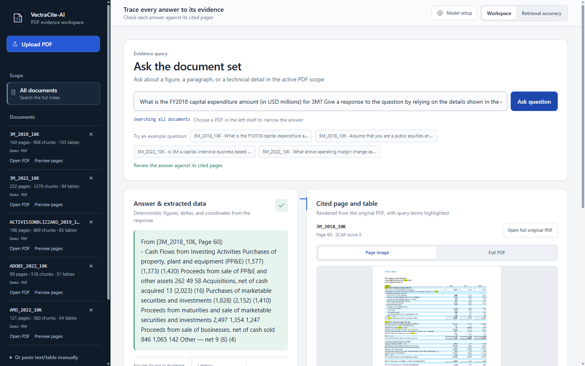
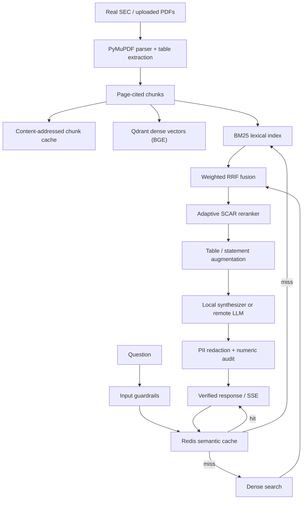

<p align="center">
  
</p>

<h1 align="center">VectraCite-AI</h1>

<p align="center">
  <strong>Neuro-symbolic document intelligence for PDFs.</strong><br />
  Table-preserving ingestion · hybrid retrieval · deterministic numeric verification · optional OpenAI-compatible synthesis
</p>

<p align="center">
  <a href="https://github.com/Abood991B/vectracite-ai/actions"></a>
  <a href="https://www.python.org/"></a>
  <a href="https://fastapi.tiangolo.com/"></a>
  <a href="https://qdrant.tech/"></a>
  <a href="LICENSE"></a>
</p>

---

VectraCite-AI is a self-hostable document intelligence service for PDFs where answers must be
checkable. It preserves tables during ingestion, retrieves evidence with dense and lexical search,
produces a cited answer, and audits numeric claims against the cited pages.

The repository ships with a real, SHA256-verified SEC filing corpus and FinanceBench questions, so
the finance and domain benchmarks run from checked-in PDFs. The default synthesizer is local and
deterministic; an OpenAI-compatible endpoint is optional.

> [!TIP]
> The verified path is CPU-hosted and single-user, with optional multi-replica operation on shared
> Qdrant and Redis. See [Deployment notes](#deployment-notes) for hardening and multi-tenant guidance.



## Contents

- [At a glance](#at-a-glance)
- [Highlights](#highlights)
- [Architecture](#architecture)
- [Corpus and benchmarks](#corpus-and-benchmarks)
- [Quickstart](#quickstart)
- [API](#api)
- [Optional remote LLM](#optional-remote-llm)
- [Testing and quality gates](#testing-and-quality-gates)
- [Project layout](#project-layout)
- [Documentation](#documentation)
- [Deployment notes](#deployment-notes)
- [Scope and limitations](#scope-and-limitations)

## At a glance

| Signal | Measured |
|---|---|
| Citation accuracy, frozen confirmation set | **6/6** answers cite the labelled statement page and contain the gold value |
| Non-finance answer set | **10/12** cited, **10/12** value |
| Cached query throughput | **685 req/s**, p95 5.9 ms, 0 errors (local in-memory cache) |
| Cold start to first answer | **20.0 s** on CPU |
| Checked-in finance corpus | 5 real 10-Ks, 830 pages, 4,154 page-cited chunks |
| Test suite | **192 passed, 2 skipped** in 62.1 s (2026-11-04) |

All figures above come from the checked-in corpus, labelled sets, and reports; the full suite, corpus
hashes, and benchmark reports were re-run on 2026-11-04.

## Highlights

| Capability | What it does |
|---|---|
| **Table-aware ingestion** | PyMuPDF extracts native and text-aligned tables as Markdown. Every chunk keeps its physical PDF page for citations. |
| **Hybrid retrieval** | Dense BGE-small embeddings, BM25, and weighted Reciprocal Rank Fusion (`0.95` / `0.05` by default), with document-scoped search. |
| **Adaptive reranking** | SCAR (Speculative Cell-Coordinate AST Reranker) runs the BGE cross-encoder only when a table-AST signal is strong, so ordinary queries keep the fused order. |
| **Verified answers** | A deterministic verifier checks numeric claims against cited chunks and supported table deltas, then reports whether they are grounded and whether verification applies. |
| **Guarded pipeline** | Regex-based prompt-injection blocking, PII redaction (including across SSE chunks), reader/admin API-key roles, and upload size/page/time limits. |
| **Semantic cache** | Exact SHA256 lookup plus Redis Stack HNSW vector search, with a bounded in-memory fallback when Redis or the `search` module is unavailable. |
| **Streaming** | `/query/stream` sends redacted model tokens, then a `verification` event and `done`. Uploads stream page progress and support cooperative cancellation. |
| **Browser workbench** | A single-page studio for document management, scoped questions, verified answers, and source-page images with highlighted query terms. |
| **Multi-replica safety** | Redis mutation lease with heartbeat renewal, `commit_epoch` fencing, and hydration reconciliation for shared Qdrant deployments. |

**Stack:** Python 3.10+ · FastAPI · PyMuPDF · Qdrant · Redis Stack · sentence-transformers · MLflow · Docker · Kubernetes

## Architecture



### Request path

1. Validate and normalize the question, correct common finance terms, and infer a document scope.
2. Apply input guardrails, then look for an exact or semantic cache hit.
3. Retrieve dense and BM25 candidates, fuse them with weighted RRF, and rerank adaptively.
4. Add document table chunks and consolidated-statement pages when the question needs them.
5. Synthesize a cited answer locally, or call the configured remote provider.
6. Filter citations to retrieved evidence, redact PII, and audit numeric claims.
7. Return JSON or stream tokens plus the verification event, then store the answer in the cache.

### Layers

The Dependency Rule is enforced by `scripts/check_layers.py`: **49 modules, 0 inward violations,
0 dependency cycles**.

| Layer | Modules | Responsibility |
|---|---|---|
| Domain | `src/domain/` | Chunks, evidence, citations, financial-statement pages, attributes, OCR contract |
| Use cases | `src/usecases/` | Query normalization, scoping, evidence selection, synthesis, document lifecycle, ports |
| Adapters | `src/retrieval/`, `src/ingestion/`, `src/cache_and_guardrails/`, `src/inference/`, `src/adapters/` | Qdrant, BM25, BGE models, Redis, PyMuPDF, HTTP providers, filesystem |
| API | `src/api/` | FastAPI routes, auth, middleware, mutation lease, browser workbench |

Key modules:

| Component | Module |
|---|---|
| PDF parsing, table extraction, pagination | `src/ingestion/pdf_parser.py` |
| Parsed-chunk and embedding caches | `src/ingestion/corpus_cache.py`, `src/retrieval/embedding_cache.py` |
| Dense + BM25 + RRF | `src/retrieval/hybrid_retriever.py`, `src/retrieval/lexical_index.py` |
| Table AST and symbolic deltas | `src/retrieval/table_ast.py` |
| Adaptive SCAR reranker | `src/retrieval/reranker.py` |
| Structural number parsing | `src/retrieval/financial_numbers.py` |
| Evidence selection and synthesis | `src/usecases/answer_pipeline.py`, `src/usecases/synthesis.py` |
| Numeric verification | `src/cache_and_guardrails/numeric_verifier.py` |
| Semantic cache and guardrails | `src/cache_and_guardrails/semantic_cache.py`, `src/cache_and_guardrails/guardrails.py` |
| Auth, body limits, mutation lease | `src/api/security.py`, `src/api/middleware.py`, `src/api/distributed_lock.py` |
| FastAPI routes and workbench | `src/api/main.py`, `src/api/static/workbench.html` |

### Cache, sync, and streaming

- `SemanticCache` uses exact SHA256 lookup plus Redis Stack HNSW vector search, with a bounded memory
  fallback. `/health` reports `vector_index: true` when the index is ready.
- Index replicas refresh from Qdrant only when the shared `vectracite:index:generation` counter
  changes; Redis-unavailable deployments fall back to a point-count check.
- Page images are cached in a bounded 128-entry LRU with ETag/304 support and
  `private, max-age=3600`.
- `/query/stream` streams model tokens through a boundary-safe redactor; the workbench consumes the
  stream and falls back to `/query` if streaming fails.

## Corpus and benchmarks

### Checked-in corpus

The demo corpus is made of **real, publicly available FinanceBench filings**, not synthetic PDFs:

| Document | Pages | Bytes | Source |
|---|---:|---:|---|
| `AMD_2022_10K` | 121 | 5,122,473 | Patronus AI FinanceBench |
| `3M_2022_10K` | 252 | 1,655,681 | Patronus AI FinanceBench |
| `3M_2018_10K` | 160 | 1,252,586 | Patronus AI FinanceBench |
| `ADOBE_2022_10K` | 99 | 620,288 | Patronus AI FinanceBench |
| `ACTIVISIONBLIZZARD_2019_10K` | 198 | 1,274,941 | Patronus AI FinanceBench |

Every file is verified by SHA256, byte size, and page count in
[`data/corpus_pdfs/manifest.json`](data/corpus_pdfs/manifest.json). The 16 benchmark questions come
from the FinanceBench ground truth for these documents; FinanceBench's 0-based evidence pages are
calibrated to physical PDF pages by text containment (offset `+1`, 0.99–1.00 containment).

### FinanceBench ablation

```bash
python evaluation/run_ablation_benchmark.py
```

The benchmark is answer-blind: it indexes the five filings, asks the 16 checked-in questions, and
compares three retrieval modes. The checked-in
[`data/latest_evaluation_report.json`](data/latest_evaluation_report.json) was generated on CPU with
`BAAI/bge-small-en-v1.5` and `BAAI/bge-reranker-base`:

| Mode | Precision@1 | Recall@3 | MRR | nDCG@3 | Mean latency |
|---|---:|---:|---:|---:|---:|
| Dense-only | 0.2500 | 0.3750 | 0.3177 | 0.3207 | 35.66 ms |
| Hybrid RRF | 0.2500 | 0.3750 | 0.3177 | 0.3207 | 67.54 ms |
| Adaptive SCAR reranker | 0.2500 | 0.3750 | 0.3177 | 0.3207 | 67.24 ms |

This is a deliberately hard retrieval-only slice: the questions require multi-page reasoning and the
three modes tie at the page level, so the ablation acts as a regression guard rather than a claim that
reranking improves every corpus. The adaptive gate keeps the fused ranking unless a strong table-AST
lock exists, which is why it does not degrade non-table queries. Only real-corpus results are
published.

### Multi-domain and RAGBench suites

The page-level domain suite covers finance, public health, AI governance, legal, and academic ML
PDFs: 17 cases, 9 documents, and 4,679 indexed chunks.

```bash
python scripts/fetch_domain_corpus.py --verify
python -m evaluation.domain_benchmark --output data/domain_benchmark_report.json
```

Checked-in report: [`data/domain_benchmark_report.json`](data/domain_benchmark_report.json)
(generated 2026-11-03 on CPU):

| Mode | P@1 | R@3 | MRR | nDCG@3 | Mean latency | p95 latency |
|---|---:|---:|---:|---:|---:|---:|
| Dense-only | 0.4118 | 0.6471 | 0.5510 | 0.5448 | 33.55 ms | 37.10 ms |
| Hybrid RRF | 0.3529 | 0.6471 | 0.5216 | 0.5231 | 59.91 ms | 93.94 ms |
| Hybrid + adaptive reranker | 0.2941 | 0.6471 | 0.4922 | 0.5014 | 65.15 ms | 110.62 ms |

Dense-only remains the strongest page-level ranker on this suite; hybrid fusion and the adaptive gate
keep the same R@3 but add latency. The suite is a cross-domain stress test over legal, academic, and
public-health prose, not a product benchmark. The adaptive gate is retained because it protects
table-heavy finance queries without degrading the fused ranking, while the end-to-end citation sets
below measure the answer path users actually see.

Phase 2 tested fusion weights, candidate depth, embedding upgrades, page fusion, and reranker gates.
A forced top-2 gate raised the domain-suite R@3 to 0.7647, but it reduced the original FinanceBench
P@1 from 0.2500 to 0.1250 and MRR from 0.3125 to 0.2500. It was rejected; the default remains on
`RERANKER_GATE=adaptive`. The full matrix, including rejected variants, is in
[`data/retrieval_experiments_baseline_gates.json`](data/retrieval_experiments_baseline_gates.json).

The passage-level RAGBench suite adds five public datasets (`covidqa`, `cuad`, `emanual`, `finqa`,
`expertqa`) with 60 cases, 160 passages, bootstrap confidence intervals, and paired comparisons:

```bash
python -m evaluation.domain_benchmark --source ragbench \
  --max-cases-per-config 12 --output data/ragbench_report.json
```

| Mode | P@1 | R@3 | MRR | nDCG@3 |
|---|---:|---:|---:|---:|
| Dense-only | 0.5833 | 0.7833 | 0.6853 | 0.6986 |
| Hybrid RRF | 0.5833 | 0.8000 | 0.6936 | 0.7091 |
| Hybrid + adaptive reranker | 0.5833 | 0.8000 | 0.6936 | 0.7091 |

Checked-in report: [`data/ragbench_report.json`](data/ragbench_report.json). The harness downloads the
five public datasets on first run; the checked-in report lets you inspect results without rerunning
it. RAGBench is retrieval-only; page-level citation quality is measured by the PDF suites.

### End-to-end citation sets

`scripts/score_retrieval_quality.py` runs the real `AnswerService.execute` and evidence-selection path,
so a change is scored end to end: whether the rendered answer cites the labelled statement page and
contains the gold value, with retrieval rank reported alongside.

```bash
python scripts/score_retrieval_quality.py --cases data/retrieval_quality_heldout.json
```

| Set | Cases | Scope | Last measured |
|---|---:|---|---|
| `retrieval_quality_cases.json` | 11 | Tuning set: headcount and comparison questions | 11/11 cited and value |
| `retrieval_quality_heldout.json` | 8 | Gross profit, operating income, R&D, cash flow, total assets | 8/8 cited and value |
| `retrieval_quality_confirmation.json` | 6 | Unused metrics and pages, measured once after rules froze | 6/6 cited and value |
| `retrieval_quality_domains.json` | 12 | Non-finance: academic ML, AI governance, legal, public health | 10/12 cited and value |

The tuning and held-out sets were both iterated on, so their scores are in-sample. The confirmation
set was written first and measured once against frozen rules, making **6/6** the clean generalization
result. The non-finance set is a 12-case diagnostic expansion; the current code reaches **10/12 cited
and 10/12 value**. Two cases still fail and both are recorded below: a SCOTUS holding page that
neither dense nor lexical ranking retrieves, and a LLaMA results table whose BoolQ column is
mis-parsed.

Checked-in results: [`data/retrieval_quality_domains_report.json`](data/retrieval_quality_domains_report.json),
[`data/retrieval_quality_confirmation_report.json`](data/retrieval_quality_confirmation_report.json),
and the per-set reports beside them. Each is written by the command above.

### Performance

Measured with `scripts/bench_hot_paths.py` in `http` mode on 2026-11-04: live API, real BGE models on
CPU, in-memory Qdrant, Redis absent. Numbers are only comparable within the same mode.

| Metric | Baseline | Budget |
|---|---:|---:|
| `/query` p95, cache miss | 194.36 ms | ≤ 250 ms |
| `/query` p95, cache hit | 2.29 ms | ≤ 25 ms |
| `/query/stream` time-to-first-byte p95 | 206.93 ms | ≤ 500 ms |
| `/ingest/pdf` 5-page p95 | 1875.52 ms | ≤ 3500 ms |
| Cold start → first answered request | 20.0 s | ≤ 120 s |
| `/evaluate/latest` p95 | 17.38 ms | ≤ 50 ms |
| Workbench `GET /` p95 | 1.76 ms | ≤ 20 ms |

Load behavior, 30 s at concurrency 4: **6.6 req/s, p95 756 ms, 0 errors** uncached; 20 s cached:
**685 req/s, p95 5.9 ms, 0 errors**. The single-request budgets above are what the workbench sees;
under four concurrent requests the cross-encoder serializes on CPU, which is the throughput limit.
Reproduce:

```bash
python scripts/bench_hot_paths.py --mode inproc --iterations 15
python scripts/bench_hot_paths.py --mode http --base-url http://127.0.0.1:8080 --iterations 10
python scripts/load_test.py --base-url http://127.0.0.1:8080 --duration 30 --concurrency 4
python scripts/load_test.py --base-url http://127.0.0.1:8080 --duration 20 --concurrency 4 --use-cache
```

The full profile, optimization ledger, and capacity triggers are in
[`docs/PERFORMANCE.md`](docs/PERFORMANCE.md).

### OCR status

Digital PDFs use the native PyMuPDF text layer and remain the fast path. OCR is optional
(`OCR_ENABLED=false` by default). On this 6 GB workstation, PP-OCRv5 mobile took 5.42 s to load and
16.40 s for a 1157×772 crop at 0.9518 confidence; PaddleOCR-VL took 415.66 s for the same crop and
OvisOCR2 did not finish within 15 minutes. Those VLM paths are not interactive on this GPU. For
production scanned PDFs, use a remote GPU OCR service (`OCR_ENGINE=remote`) or install the optional
PP-OCRv5 fallback for low-volume work. Details: [`docs/ocr.md`](docs/ocr.md).

## Quickstart

### Prerequisites

- Python 3.10+ (CI uses 3.11)
- Docker and Docker Compose for the full stack; local mode can run without either
- No GPU required; CPU-only PyTorch is the verified path
- Disk space for the models on first run (BGE-small and the BGE cross-encoder)

### Local Python

```bash
git clone https://github.com/Abood991B/vectracite-ai.git
cd vectracite-ai
python -m venv .venv

# Windows PowerShell:
.\.venv\Scripts\Activate.ps1
# macOS/Linux:
# source .venv/bin/activate

pip install -r requirements.txt

# Verify the committed real corpus (no network required):
python scripts/fetch_real_pdf_corpus.py --verify

# Single-user local mode: in-memory vectors, no Docker, no Redis.
python scripts/run_local.py
```

`scripts/run_local.py` starts uvicorn on `127.0.0.1:8080` and sets `QDRANT_IN_MEMORY=true` unless you
exported a value yourself. On first start it downloads the embedding and reranker models, so it needs
network access once. Use `--port` to move it, or run `uvicorn src.api.main:app --host 127.0.0.1
--port 8080` after exporting `QDRANT_IN_MEMORY=true`. A bare uvicorn start with no Qdrant server and
no flag is refused, and the error names both working options.

Uploaded PDFs live in `data/uploads` and are re-indexed on the next start, so local mode survives a
restart without a database. The demo corpus is loaded from the committed caches.

Open `http://127.0.0.1:8080/` for the workbench and `http://127.0.0.1:8080/docs` for OpenAPI.
Bind to `127.0.0.1` unless you intend to expose the service. Authentication is disabled by default.

In the workbench, remove the demo documents, upload a PDF, and ask a question scoped to that
document. Check the cited pages against the original PDF. The upload limit defaults to 25 MiB and
500 pages, and parsing has a 120-second timeout. Citations and page images use physical PDF page
numbers. Source page labels remain visible as document text.

OCR is disabled by default. When enabled, it applies only to image-containing pages with fewer than
`OCR_MIN_CHARS` native characters; exactly white pages are reported as blank and skipped. The upload
response reports extraction coverage per physical page; for high-stakes extraction, inspect the
original pages. Ingestion permits one active parser per API process.

The committed `data/corpus_index.json` and `data/corpus_embeddings.npz` reduce startup work when
their signatures match the configuration and corpus. A stale cache fails fast rather than silently
re-parsing.

### Docker Compose

```bash
# PowerShell
$env:API_READ_KEY = "replace-with-a-long-random-read-key"
$env:API_ADMIN_KEY = "replace-with-a-distinct-long-random-admin-key"
docker compose up -d --build

# macOS/Linux:
# export API_READ_KEY="replace-with-a-long-random-read-key"
# export API_ADMIN_KEY="replace-with-a-distinct-long-random-admin-key"
# docker compose up -d --build
```

Compose starts the API, Qdrant, Redis Stack, and MLflow. It builds the API with the BGE models
preloaded, waits for dependency health checks, and uses `/ready` for the API healthcheck. Uploaded
PDFs persist in the `api_uploads` volume. Qdrant, Redis, and MLflow host ports bind to `127.0.0.1`;
their services remain reachable on the Compose network.

### Kubernetes

```bash
kubectl apply -f k8s/dependencies.yaml
kubectl apply -f k8s/secret.example.yaml   # replace the example keys first
kubectl apply -f k8s/deployment.yaml
```

`k8s/dependencies.yaml` provides Qdrant, Redis, and MLflow Deployments, Services, and PVCs.
`k8s/deployment.yaml` runs two API replicas behind a private ClusterIP Service with readiness,
liveness, HPA, and `/ready` checks. The uploads PVC requires a `ReadWriteMany` storage class; change
it to `ReadWriteOnce` for a single replica or provide shared object storage.

With `REQUIRE_REDIS=true`, every mutation takes a renewed Redis lease, so conflicting writes from
different replicas serialize (or fail with `503`) instead of interleaving. Without Redis, run a
single replica: the in-process lock cannot coordinate writers in another process.

### Optional GPU and MLOps

Optional dependencies are intentionally separate:

```bash
pip install -r requirements-gpu.txt    # torch, transformers, peft, trl, bitsandbytes, vllm
pip install -r requirements-mlops.txt  # kfp, google-cloud-aiplatform, google-cloud-storage
pip install -r requirements-ocr.txt    # paddleocr, paddlepaddle, pillow
```

The QLoRA, vLLM, and KFP files are optional engineering paths. GPU hardware, a live vLLM endpoint,
and cloud KFP submission were not exercised in this environment; the verified path is the CPU/API/
real-corpus stack described above.

### Configuration

All settings are environment variables read by `src/config.py`. The main ones are listed in
[`.env.example`](.env.example); the authoritative defaults are in `src/config.py`.

| Variable | Default | Purpose |
|---|---|---|
| `QDRANT_IN_MEMORY` | `false` | Run the vector store in-process, with no Qdrant server |
| `QDRANT_HOST` / `QDRANT_PORT` | `127.0.0.1` / `6333` | Qdrant endpoint; use `127.0.0.1`, not `localhost`, on Windows |
| `EMBEDDING_MODEL` | `BAAI/bge-small-en-v1.5` | Dense embedding model |
| `RERANKER_MODEL` | `BAAI/bge-reranker-base` | Cross-encoder reranker |
| `RERANKER_GATE` | `adaptive` | `adaptive` or a forced top-k gate |
| `REDIS_URL` | `redis://127.0.0.1:6379/0` | Redis Stack for cache and index generation |
| `REQUIRE_REDIS` | `false` | Fail readiness and enable the cross-replica lease |
| `AUTH_REQUIRED` | `false` | Require API keys |
| `API_READ_KEY` / `API_ADMIN_KEY` | empty | Distinct reader and admin credentials |
| `LLM_REMOTE_ENABLED` | `false` | Use an OpenAI-compatible provider instead of local synthesis |
| `OCR_ENABLED` | `false` | Enable OCR for image-only pages |
| `MAX_PDF_BYTES` / `MAX_PDF_PAGES` | `25 MiB` / `500` | Upload limits |
| `INGEST_TIMEOUT_SECONDS` | `120` | Parse timeout |

## API

| Method | Endpoint | Notes |
|---|---|---|
| `GET` | `/` | Browser workbench |
| `GET` | `/health` | Process liveness plus cache stats |
| `GET` | `/ready` | Deep check: degraded vector backend or required Redis loss |
| `GET` | `/metrics` | Indexed chunks/documents, cache stats, models, provider, retriever health |
| `GET` | `/documents` | Document, chunk, table, and page summaries |
| `GET` | `/documents/{doc_name}` | Paginated chunks (`limit`, `offset`) |
| `GET` | `/documents/{doc_name}/pdf` | Original PDF |
| `GET` | `/documents/{doc_name}/pages/{page}/image` | Rendered page PNG with optional highlights |
| `POST` | `/query` | Guarded JSON answer with citations and verification |
| `POST` | `/query/stream` | Guarded SSE: `token`, `verification`, then `done` |
| `POST` | `/ingest/pdf` | Upload and index a PDF |
| `POST` | `/ingest/pdf/stream` | Upload a PDF and stream page progress plus the indexing result |
| `POST` | `/ingest` | Render structured pages to PDF, then index |
| `PUT` | `/documents/{doc_name}` | Atomic replace |
| `DELETE` | `/documents/{doc_name}` | Delete |
| `POST` | `/documents/clear-demos` | Remove demo documents only |
| `POST` | `/documents/restore-defaults` | Restore demo documents |
| `POST` | `/documents/clear-all` | Clear index and uploads |
| `GET` | `/scenarios` | Benchmark scenarios for currently indexed documents |
| `GET` | `/evaluate/latest` | Persisted report when its signature matches the index |
| `POST` | `/evaluate` | Run the real ablation on the current index |
| `GET` | `/config/llm` | Safe provider metadata (no API key) |
| `POST` | `/config/llm` | Update the remote provider at runtime |
| `POST` | `/config/llm/test` | Probe provider reachability without a completion |

Authentication uses `X-API-Key` or `Authorization: Bearer`. Reader keys can query and read; admin
keys can mutate. Set `AUTH_REQUIRED=true`, `API_READ_KEY`, and `API_ADMIN_KEY` for deployments; the
service fails closed if authentication is enabled without two distinct keys.

```bash
# macOS/Linux; in PowerShell use curl.exe
curl -s http://127.0.0.1:8080/query \
  -H "Content-Type: application/json" \
  -H "X-API-Key: $API_READ_KEY" \
  -d '{"question":"Did AMD report customer concentration in FY22?","doc_name":"AMD_2022_10K"}'
```

The streaming upload can be cancelled by disconnecting during parsing. OCR already in progress may
finish first. Once indexing starts, it continues even if the client disconnects, to avoid
interrupting the document update.

### Example verified response

From [`data/live_system_showcase_output.json`](data/live_system_showcase_output.json), trimmed to the
first citation and the three capex cells:

```json
{
  "question": "What is the FY2018 capital expenditure amount (in USD millions) for 3M? Give a response to the question by relying on the details shown in the cash flow statement.",
  "answer": "From [3M_2018_10K, Page 60]:\n- Cash Flows from Investing Activities Purchases of property, plant and equipment (PP&E) (1,577) (1,373) (1,420) Proceeds from sale of PP&E and other assets 262 49 58 Acquisitions, net of cash acquired 13 (2,023) (16) Purchases of marketable securities and investments (1,828) (2,152) (1,410) Proceeds from maturities and sale of marketable securities and investments 2,497 1,354 1,247 Proceeds from sale of businesses, net of cash sold 846 1,065 142 Other — net 9 (6) (4)",
  "matched_cells": [
    {
      "doc_name": "3M_2018_10K",
      "page_number": 60,
      "row_key": "Purchases of property, plant and equipment (PP&E)",
      "col_header": "2018",
      "value": "**(1,577)**",
      "row_index": 13,
      "col_index": 3
    },
    {
      "doc_name": "3M_2018_10K",
      "page_number": 60,
      "row_key": "Purchases of property, plant and equipment (PP&E)",
      "col_header": "2017",
      "value": "(1,373)",
      "row_index": 13,
      "col_index": 6
    },
    {
      "doc_name": "3M_2018_10K",
      "page_number": 60,
      "row_key": "Purchases of property, plant and equipment (PP&E)",
      "col_header": "2016",
      "value": "(1,420)",
      "row_index": 13,
      "col_index": 9
    }
  ],
  "computed_deltas": [],
  "citations": [
    {
      "chunk_id": "0668347e6339",
      "doc_name": "3M_2018_10K",
      "page_number": 60,
      "contains_table": true,
      "rerank_score": 0.0,
      "excerpt": "[DOCUMENT: 3M_2018_10K | PAGE: 60]\nEXTRACTED TABLES (PAGE 60)\n|(Millions)|Col2|Col3|2018|Col5|Col6|2017|Col8|Col9|2016|"
    }
  ],
  "verification": {
    "is_fully_grounded": true,
    "numeric_grounding_score": 1.0,
    "verified_figures": ["(1,577)", "(1,373)", "(1,420)", "262", "49", "58"],
    "unverified_figures": [],
    "verification_applicable": true
  },
  "cache_hit": false,
  "cache_similarity": null,
  "latency_ms": 348.67,
  "guardrail_flags": [],
  "metadata": {
    "retrieval_strategy": "hybrid_rrf_plus_table_schema_cross_encoder",
    "candidates_evaluated": 6,
    "document_scope": "3M_2018_10K",
    "answer_provider": "local_deterministic",
    "provider_error": null
  }
}
```

A second identical request returns `cache_hit: true` in 0.7 ms. The injection probe in the same
artifact returns HTTP 400.

> [!IMPORTANT]
> Numeric verification confirms that figures in the answer appear in the cited evidence or in a
> supported table calculation. It is a grounding aid, not a semantic correctness guarantee: entity
> attribution and whether a statement follows from the evidence are evaluated by the labelled
> citation sets and remain the synthesizer's responsibility. `is_fully_grounded` is the legacy field
> name for this numeric check. When an answer contains no recognized numeric claims,
> `verification_applicable` is `false` and the workbench shows `N/A`.

## Optional remote LLM

The deterministic local synthesizer is the default. An OpenAI-compatible endpoint can be configured
at runtime by an admin (`POST /config/llm`) or through environment variables:

```bash
# macOS/Linux
export LLM_REMOTE_ENABLED=true
export LLM_BASE_URL=http://localhost:8000/v1
export LLM_API_KEY=EMPTY
export LLM_MODEL_NAME=meta-llama/Llama-3.1-8B-Instruct

# Windows PowerShell
# $env:LLM_REMOTE_ENABLED = "true"
# $env:LLM_BASE_URL = "http://localhost:8000/v1"
# $env:LLM_API_KEY = "EMPTY"
# $env:LLM_MODEL_NAME = "meta-llama/Llama-3.1-8B-Instruct"
```

Remote answers must cite pages that exist in the retrieved evidence, otherwise the client falls back
to the local synthesizer. Remote output still passes through PII redaction and numeric verification.
The provider reuses one `httpx.AsyncClient` per event loop and falls back to local synthesis after a
failed call.

To enable the browser-side token stream, no extra configuration is required: `/query/stream` emits
`token` events, then the full `verification` payload, then `done`.

## Testing and quality gates

Fixture-based unit and API tests use the four small synthetic PDFs in `tests/fixtures/corpus_pdfs`.
Real PDFs, production models, and corpus checks are marked `integration`; they run in the same
`pytest -q` command unless you deselect them.

```bash
pytest -q                                  # full suite
pytest -q -m integration                   # real PDFs and production models only
pytest -q -m "not integration"             # fast fixture path

ruff check src/ tests/ evaluation/ scripts/ training_and_vllm/ k8s/
python scripts/check_layers.py             # 0 inward violations, 0 cycles
python scripts/bench_hot_paths.py --mode inproc --iterations 3 --warmup 1 --gate
```

On 2026-11-04 the full suite reported **192 passed, 2 skipped in 62.1 s**; the skips are
Redis-dependent. CI also runs lint and compile checks, the Dependency Rule check, the documentation
link check, corpus verification, the hot-path budget gate, and a container smoke test with
lightweight models. An optional KFP compile job verifies the pipeline definition.

For two-process concurrency checks after touching the mutation path:

```bash
python scripts/multi_replica_check.py --base-url http://127.0.0.1:8081 --base-url http://127.0.0.1:8082
```

This needs two live API processes sharing Qdrant, Redis, and the uploads directory.

## Project layout

```text
vectracite-ai/
├── src/
│   ├── api/                    # FastAPI routes, auth, middleware, lease, workbench
│   ├── domain/                 # Chunks, evidence, citations, statements, attributes
│   ├── usecases/               # Normalization, scoping, evidence selection, synthesis, documents
│   ├── retrieval/              # Dense + BM25 + RRF, table AST, adaptive reranker
│   ├── ingestion/              # PyMuPDF parser, OCR, corpus cache
│   ├── cache_and_guardrails/   # Semantic cache, guardrails, numeric verifier
│   ├── inference/              # Local/remote synthesis client and schemas
│   └── adapters/               # Uploads, page images, Redis clients, evaluation runner
├── data/
│   ├── corpus_pdfs/            # 5 real SEC filings + SHA256 manifest
│   ├── domain_corpus_pdfs/     # Public health, AI, legal, academic PDFs
│   ├── corpus_index.json       # Parsed-chunk cache
│   ├── corpus_embeddings.npz   # Cached BGE vectors
│   ├── benchmark_queries.json  # 16 calibrated FinanceBench questions
│   ├── retrieval_quality_*.json # Labelled sets and measured citation reports
│   └── *_report.json           # Evaluation and load-test evidence
├── evaluation/                 # FinanceBench ablation, domain/RAGBench harness, experiments
├── scripts/                    # Corpus fetch/verify, cache build, benchmarks, layer check
├── tests/                      # Unit, API, regression, and integration tests
├── docs/                       # Architecture, performance, reliability, testing, evaluation
├── k8s/                        # Dependencies, API deployment, Vertex AI pipeline
├── training_and_vllm/          # Optional QLoRA, vLLM serve and benchmarks
├── Dockerfile
├── docker-compose.yml
└── pyproject.toml
```

## Documentation

| Document | Contents |
|---|---|
| [`docs/ARCHITECTURE.md`](docs/ARCHITECTURE.md) | Layer map, dependency rule, bounded contexts, data decisions, ADR log |
| [`docs/PERFORMANCE.md`](docs/PERFORMANCE.md) | Hot-path baselines, budgets, profiling, optimization ledger, capacity triggers |
| [`docs/RELIABILITY.md`](docs/RELIABILITY.md) | Integration audit, circuit breakers, health/metrics, deploy vs release, lease evidence |
| [`docs/TESTING.md`](docs/TESTING.md) | Test pyramid, safety-net map, characterization backlog, CI gates |
| [`docs/caching_streaming.md`](docs/caching_streaming.md) | Semantic cache, index sync, page-image cache, SSE redaction |
| [`docs/ocr.md`](docs/ocr.md) | OCR measurements, engine comparison, recommendation |
| [`docs/domain_benchmark.md`](docs/domain_benchmark.md) | Multi-domain benchmark design and metrics |
| [`docs/retrieval_experiments.md`](docs/retrieval_experiments.md) | Fusion, embedding, and gate experiments |
| [`docs/query-interpreter.md`](docs/query-interpreter.md) | Measured query-rewriter experiment and adoption trigger |
| [`docs/followup_evaluation.md`](docs/followup_evaluation.md) | Retrieval, answer, and OCR diagnostic observations |

## Deployment notes

The verified deployment is a CPU-hosted API with shared Qdrant and Redis Stack. It is designed for
local evaluation, internal tools, and controlled deployments. Treat the following as deployment
requirements, not optional hardening:

- Put authentication and tenant isolation at the gateway for any multi-user or multi-team
  deployment. The API ships shared reader and admin keys.
- Add TLS, audit logging, secret rotation, network policies, and abuse controls before exposing the
  service publicly.
- Validate backup/restore, disaster recovery, sustained load, and GPU configuration in your own
  environment before depending on them.
- Upload cancellation is cooperative between pages, an OCR call already running cannot be
  interrupted, and jobs are not durable across restart.
- For high-stakes answers, add an independent evaluation on your own documents. The labelled sets in
  this repository measure this corpus; numeric grounding is not a semantic correctness guarantee.

| Target | Path |
|---|---|
| Local Python | `uvicorn src.api.main:app`, optional `QDRANT_IN_MEMORY=true` |
| Docker Compose | API, Qdrant, Redis Stack, and MLflow with health checks |
| Kubernetes | Two API replicas, HPA, readiness/liveness, shared uploads PVC |

## Scope and limitations

- The local synthesizer is extractive and structural, optimized for financial statements and
  document-grounded answers. Complex multi-page reasoning can use the optional remote provider.
- The FinanceBench slice is small and deliberately difficult; the retrieval numbers are a regression
  guard, not a general accuracy claim. The end-to-end citation sets are the primary answer-quality
  evidence.
- The multi-domain suite has 17 cases and one reference page per case. It is a diagnostic suite, not
  an external leaderboard. RAGBench is retrieval-only.
- The forced top-2 reranker was measured and rejected because it improved R@3 but reduced MRR on the
  labelled set. The adaptive gate remains the default; GPU reranker execution is not part of the
  verified path.
- OCR is optional and disabled by default. Native extraction is the fast path; local PP-OCRv5 is
  CPU-slow, and the tested VLM OCR paths are not interactive on a 6 GB GPU. A remote OCR service is
  the recommended path for scanned collections.
- GPU QLoRA, vLLM serving, Kubernetes scheduling/storage, and cloud KFP execution require external
  infrastructure and are not exercised in the verified CPU path.

## Author

**Abdulrahman Baidaq** — AI/ML Engineer

[GitHub: Abood991B](https://github.com/Abood991B)
