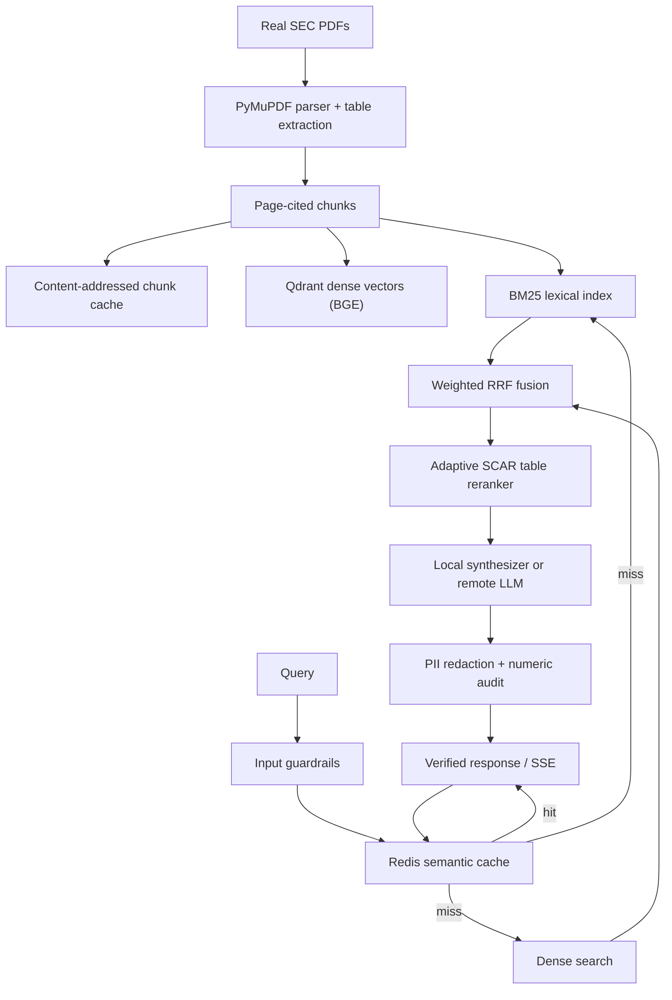

<p align="center"></p>

# VectraCite-AI

**Neuro-symbolic document intelligence: table-preserving ingestion, hybrid retrieval, deterministic numeric verification, and optional OpenAI-compatible synthesis.**

[](https://github.com/Abood991B/vectracite-ai/actions)
[](https://www.python.org/)
[](https://fastapi.tiangolo.com/)
[](https://qdrant.tech/)

---

## 1. What VectraCite-AI does

VectraCite-AI is a self-hostable document question-answering service built around a real SEC filing corpus. It:

- Parses PDFs with PyMuPDF, preserving native and text-aligned tables as Markdown.
- Chunks extracted content and records its physical PDF page for citations.
- Retrieves with dense BGE embeddings, BM25, and weighted Reciprocal Rank Fusion.
- Reranks with a BGE cross-encoder only when a table-AST structural signal is strong.
- Produces citation-grounded answers through a deterministic local synthesizer or an optional OpenAI-compatible provider.
- Audits every numeric claim in the answer against the cited evidence and marks the result as grounded, ungrounded, or not applicable.
- Blocks prompt injection, redacts PII, supports API-key roles, and streams the fully guarded answer over SSE.

The checked-in demo corpus is made of **real, publicly available FinanceBench filings**, not synthetic PDFs:

| Document | Pages | Bytes | Source |
|---|---:|---:|---|
| `AMD_2022_10K` | 121 | 5,122,473 | Patronus AI FinanceBench |
| `3M_2022_10K` | 252 | 1,655,681 | Patronus AI FinanceBench |
| `3M_2018_10K` | 160 | 1,252,586 | Patronus AI FinanceBench |
| `ADOBE_2022_10K` | 99 | 620,288 | Patronus AI FinanceBench |
| `ACTIVISIONBLIZZARD_2019_10K` | 198 | 1,274,941 | Patronus AI FinanceBench |

Every file is verified by SHA256, byte size, and page count in
[`data/corpus_pdfs/manifest.json`](data/corpus_pdfs/manifest.json). The 16 benchmark questions come from
the FinanceBench ground truth for these documents; FinanceBench's 0-based evidence pages are calibrated
to physical PDF pages by text containment (offset `+1`, 0.99-1.00 containment).

---

## 2. Architecture



Key modules:

| Component | Module |
|---|---|
| PDF parsing, table extraction, pagination | `src/ingestion/pdf_parser.py` |
| Parsed-chunk and embedding caches | `src/ingestion/corpus_cache.py`, `src/retrieval/embedding_cache.py` |
| Dense + BM25 + RRF | `src/retrieval/hybrid_retriever.py` |
| Table AST and symbolic deltas | `src/retrieval/table_ast.py` |
| Adaptive table reranker | `src/retrieval/reranker.py` |
| Structural number parsing | `src/retrieval/financial_numbers.py` |
| Numeric verification | `src/cache_and_guardrails/numeric_verifier.py` |
| Semantic cache | `src/cache_and_guardrails/semantic_cache.py` |
| Guarded answer pipeline | `src/api/answer_service.py` |
| Auth, body limits, distributed lock | `src/api/security.py`, `middleware.py`, `distributed_lock.py` |
| FastAPI routes and browser workbench | `src/api/main.py`, `src/api/ui.py` |

---

## 3. Reproducible real-corpus benchmark

Run:

```bash
python evaluation/run_ablation_benchmark.py
```

The benchmark is answer-blind: it uses the 16 checked-in questions and expected evidence pages from
FinanceBench, indexes the five real filings, and evaluates three retrieval modes. The checked-in
[`data/latest_evaluation_report.json`](data/latest_evaluation_report.json) was generated on CPU with
`BAAI/bge-small-en-v1.5` and `BAAI/bge-reranker-base`:

| Mode | Precision@1 | Recall@3 | MRR | nDCG@3 | Mean latency |
|---|---:|---:|---:|---:|---:|
| Dense-only | 0.2500 | 0.3750 | 0.3177 | 0.3207 | 35.83 ms |
| Hybrid RRF | 0.2500 | 0.3750 | 0.3177 | 0.3207 | 74.36 ms |
| Adaptive SCAR reranker | 0.2500 | 0.3750 | 0.3177 | 0.3207 | 78.80 ms |

These are honest results on a difficult 830-page, five-document corpus. Retrieval is limited by the
small BGE bi-encoder and by FinanceBench questions that require multi-page reasoning. The adaptive
reranker preserves the fused ranking unless a strong table-AST lock exists, so it does not degrade
non-table queries. The repository no longer publishes the earlier synthetic 1.00 scores.

### 3.1 Domain-agnostic benchmark

FinanceBench remains the finance regression suite. A separate benchmark tests the same retrieval
stack on real PDFs from public health, AI governance, legal, and academic ML domains, plus the five
finance filings. The page-level suite contains 17 cases, 9 documents, and 5,055 indexed chunks:

```bash
python scripts/fetch_domain_corpus.py --verify
python -m evaluation.domain_benchmark --output data/domain_benchmark_report.json
```

Checked-in report: [`data/domain_benchmark_report.json`](data/domain_benchmark_report.json).

| Mode | P@1 | R@3 | MRR | nDCG@3 | Mean latency | p95 latency |
|---|---:|---:|---:|---:|---:|---:|
| Dense-only | **0.4118** | **0.5882** | **0.5431** | **0.5154** | 35.07 ms | 47.66 ms |
| Hybrid RRF | 0.4118 | 0.5294 | 0.5284 | 0.4783 | 55.05 ms | 90.45 ms |
| Hybrid + adaptive reranker | 0.4118 | 0.5294 | 0.5284 | 0.4783 | 56.99 ms | 88.73 ms |

Phase 2 tested fusion weights, candidate depth, embedding upgrades, page fusion, and reranker gates.
A forced top-2 gate raised the domain-suite R@3 to 0.7647, but it reduced the original FinanceBench
P@1 from 0.2500 to 0.1250 and MRR from 0.3125 to 0.2500 (both measured before the physical-page
citation migration; the current baseline MRR is 0.3177). It was therefore rejected; production
remains on `RERANKER_GATE=adaptive`. The full matrix, including the rejected variants, is in
[`data/retrieval_experiments_baseline_gates.json`](data/retrieval_experiments_baseline_gates.json).

The baseline also exposed a real problem: adaptive reranking did not beat dense-only, and legal
retrieval was weakest. Aggressive BM25 weighting helped short RAGBench passages but hurt the long
PDF corpus, so it was not adopted. BGE-base, E5-base, and GTE-base did not produce a clear win over
BGE-small on the RAGBench screen; see
[`data/retrieval_experiments_ragbench_embeddings.json`](data/retrieval_experiments_ragbench_embeddings.json).

A passage-level RAGBench suite adds five public datasets (`covidqa`, `cuad`, `emanual`, `finqa`,
`expertqa`) with bootstrap confidence intervals and paired comparisons:

```bash
python -m evaluation.domain_benchmark --source ragbench \
  --max-cases-per-config 12 --output data/ragbench_report.json
```

Checked-in report: [`data/ragbench_report.json`](data/ragbench_report.json). It contains 60 cases,
160 passages, and per-domain results. The adaptive reranker leaves every RAGBench metric unchanged.
This is a retrieval-only suite; page-level citation quality is measured by the PDF suite.

### 3.2 Cache, sync, and streaming

- `SemanticCache` now uses exact SHA256 lookup plus Redis Stack HNSW vector search, with a bounded
  memory fallback. `/health` reports `vector_index: true` when the index is ready.
- Index replicas refresh from Qdrant only when the shared `vectracite:index:generation` counter
  changes; Redis-unavailable deployments fall back to a point-count check.
- Page images are LRU-cached with ETag/304 support and `private, max-age=3600`.
- `/query/stream` streams true model tokens through a boundary-safe redactor; the workbench consumes
  the stream and falls back to `/query` if streaming fails.
- The remote LLM provider reuses one `httpx.AsyncClient` per event loop.

See [`docs/caching_streaming.md`](docs/caching_streaming.md) for the implementation and validation
evidence.

### 3.3 OCR status

Digital PDFs use the native PyMuPDF text layer and remain the fast path. OCR is
optional (`OCR_ENABLED=false` by default). On this 6 GB workstation, PP-OCRv5
mobile took 5.42 s to load and 16.40 s for a 1157x772 crop at 0.9518 confidence;
PaddleOCR-VL took 415.66 s for the same crop and OvisOCR2 did not finish within
15 minutes. Those VLM paths are not interactive on this GPU. For production
scanned PDFs, use a remote GPU OCR service (`OCR_ENGINE=remote`) or install the
optional PP-OCRv5 fallback for low-volume work. Details:
[`docs/ocr.md`](docs/ocr.md).

Supporting checks:

```bash
pytest -q                     # fast fixture corpus + real-corpus integration tests
pytest -q -m integration      # only the real PDF/retrieval/endpoint checks
```

The default suite uses the four small synthetic PDFs in `tests/fixtures/corpus_pdfs` for deterministic
unit tests. Real-corpus tests are marked `integration` and exercise the actual filings and BGE models.

---

## 4. Quickstart

### Local Python

```bash
git clone https://github.com/Abood991B/vectracite-ai.git
cd vectracite-ai
python -m venv .venv
# Windows PowerShell:
.\.venv\Scripts\Activate.ps1
# macOS/Linux:
# source .venv/bin/activate
pip install -r requirements.txt

# Verify the committed real corpus (no network required):
python scripts/fetch_real_pdf_corpus.py --verify

# Optional: rebuild the parsed-chunk and embedding caches after changing the parser:
python scripts/build_corpus_index.py --embeddings

# Zero-dependency local vector store:
# PowerShell: $env:QDRANT_IN_MEMORY = "true"
# macOS/Linux: export QDRANT_IN_MEMORY=true
uvicorn src.api.main:app --host 0.0.0.0 --port 8080
```

Open `http://localhost:8080/` for the workbench and `http://localhost:8080/docs` for OpenAPI.
For local use, bind to `127.0.0.1` instead of `0.0.0.0` unless you intend to
expose the service. Authentication is disabled by default.

In the workbench, remove the demo documents, upload a PDF, and ask a question
scoped to that document. Check the cited pages against the original PDF. The
upload limit defaults to 25 MiB and 500 pages, and parsing has a 120-second
timeout. The service processes all pages within those limits, but extracted
text and tables can be incomplete, especially for mixed or scanned PDFs.
Demo removal persists in the uploads directory. Citations and page images use
physical PDF page numbers, including for PDFs generated from structured input.
Source page labels remain visible as document text.
OCR is disabled by default. When enabled, it applies only to image-containing
pages with fewer than `OCR_MIN_CHARS` native characters. The default limit is
50 OCR pages; exceeding it, an OCR error, or an empty OCR result rejects the
upload. Exactly white image pages are reported as blank and skipped. Other blank
or near-blank scans may require preprocessing. A page with a short text layer above the threshold may
still contain unrecognized image content. Inspect the original pages.
The upload response reports extraction coverage per physical page. Coverage does
not establish that every visible word or table was extracted. Ingestion permits
one active parser per API process. A timeout requests cancellation between pages;
an OCR call already running can continue until it returns, retaining that slot.
`PARSER_CHUNK_OVERLAP` is currently included in cache configuration but is not
applied by the chunker.

The committed `data/corpus_index.json` and `data/corpus_embeddings.npz` can reduce
startup work when their signatures match the configuration and corpus. Startup
time depends on the machine and whether the model is already available.
The physical-page citation update uses a new Qdrant collection and invalidates
older parsed caches. The service rebuilds its index from the configured corpus
and persisted uploads. The old Qdrant collection is not deleted automatically.
Redis answer-cache entries also use a new namespace so old citations are not
reused; old entries expire according to their existing TTL.

### Docker Compose

```bash
$env:API_READ_KEY = "replace-with-a-long-random-read-key"
$env:API_ADMIN_KEY = "replace-with-a-distinct-long-random-admin-key"
docker compose up -d --build
```

Compose starts the API, Qdrant, Redis Stack, and MLflow. It builds the API with the BGE models
preloaded, waits for dependency health checks, and uses `/ready` for the API healthcheck. Uploaded
PDFs persist in the `api_uploads` volume. Qdrant, Redis, and MLflow host ports bind
to `127.0.0.1`; their services remain reachable by the Compose network.

### Kubernetes

```bash
kubectl apply -f k8s/dependencies.yaml
kubectl apply -f k8s/secret.example.yaml   # replace the example keys first
kubectl apply -f k8s/deployment.yaml
```

`k8s/dependencies.yaml` provides Qdrant, Redis, and MLflow Deployments/Services/PVCs.
`k8s/deployment.yaml` runs two API replicas behind a private ClusterIP Service with readiness,
liveness, HPA, and `/ready` checks. The uploads PVC requires a `ReadWriteMany` storage class; change
it to `ReadWriteOnce` if you run a single replica or provide shared object storage.

---

## 5. API summary

| Method | Endpoint | Notes |
|---|---|---|
| `GET` | `/health` | Process liveness only |
| `GET` | `/ready` | Fails on a degraded vector backend or required Redis loss; an empty index can accept uploads |
| `GET` | `/documents` | Document, chunk, table, and page summaries |
| `GET` | `/documents/{doc_name}` | Paginated chunks (`limit`, `offset`) |
| `GET` | `/documents/{doc_name}/pdf` | Original PDF |
| `GET` | `/documents/{doc_name}/pages/{page}/image` | Rendered page PNG with highlights |
| `POST` | `/query` | Guarded JSON answer with citations and verification |
| `POST` | `/query/stream` | Guarded SSE answer, then a `verification` event |
| `POST` | `/ingest/pdf` | Upload and index a PDF |
| `POST` | `/ingest/pdf/stream` | Upload a PDF and stream page progress and the indexing result |
| `POST` | `/ingest` | Render structured pages to PDF, then index |
| `PUT` | `/documents/{doc_name}` | Atomic replace |
| `DELETE` | `/documents/{doc_name}` | Delete |
| `POST` | `/documents/clear-demos` | Remove demo docs only |
| `POST` | `/documents/restore-defaults` | Restore demo docs |
| `POST` | `/documents/clear-all` | Clear index and uploads |
| `GET` | `/scenarios` | Benchmark scenarios for currently indexed docs |
| `GET` | `/evaluate/latest` | Persisted report when its signature matches the index |
| `POST` | `/evaluate` | Run the real ablation on the current index |
| `GET` | `/metrics` | Models, cache, and runtime telemetry |

Authentication uses `X-API-Key` or `Authorization: Bearer`; reader keys can query/read, admin keys
can mutate. Set `AUTH_REQUIRED=true`, `API_READ_KEY`, and `API_ADMIN_KEY` for deployments.
The streaming upload can be cancelled by disconnecting during parsing. OCR already
in progress may finish first. Once indexing starts, it continues even if the client
disconnects, to avoid interrupting the document update.

The numeric verification fields compare numbers with cited chunks and supported
table calculations. They do not check whether a number describes the right entity,
whether a statement follows from the evidence, or whether an answer is correct.
`is_fully_grounded` is a legacy field name for this numeric check, not a claim
that the entire answer is grounded. When an answer contains no recognized numeric
claims, `verification_applicable` is `false`.

### Example verified response

From [`data/live_system_showcase_output.json`](data/live_system_showcase_output.json):

```json
{
  "question": "Did AMD report customer concentration in FY22?",
  "answer": "According to [AMD_2022_10K, Page 12]:\nOne customer accounted for 16% of our consolidated net revenue for the year ended December 31, 2022.\nSales to this customer consisted of sales of products\nA loss of this customer would have a material adverse effect on our business.",
  "citations": [
    {
      "chunk_id": "97d58560857f",
      "doc_name": "AMD_2022_10K",
      "page_number": 12,
      "contains_table": false,
      "rerank_score": 0.0156,
      "excerpt": "[DOCUMENT: AMD_2022_10K | PAGE: 12]\nTable of Contents\n\nWe also work with our customers..."
    }
  ],
  "verification": {
    "is_fully_grounded": true,
    "numeric_grounding_score": 1.0,
    "verified_figures": ["16%", "31,", "2022"],
    "unverified_figures": [],
    "verification_applicable": true
  },
  "latency_ms": 104.49,
  "metadata": {
    "document_scope": "AMD_2022_10K",
    "answer_provider": "local_deterministic"
  }
}
```

If a response has no cited evidence (for example a meta answer or an out-of-scope response),
`verification_applicable` is `false` and the workbench displays `N/A` instead of a misleading `0%`.

---

## 6. Optional remote LLM

The deterministic local synthesizer is the default. An OpenAI-compatible endpoint can be configured
at runtime by an admin (`POST /config/llm`) or through environment variables:

```bash
export LLM_REMOTE_ENABLED=true
export LLM_BASE_URL=http://localhost:8000/v1
export LLM_API_KEY=EMPTY
export LLM_MODEL_NAME=meta-llama/Llama-3.1-8B-Instruct
```

Remote answers must cite pages that exist in the retrieved evidence, otherwise the client falls back
to the local synthesizer. Remote output still passes through PII redaction and numeric verification.

---

## 7. GPU and MLOps

Optional dependencies are intentionally separate:

```bash
pip install -r requirements-gpu.txt    # torch, transformers, peft, trl, bitsandbytes, vllm
pip install -r requirements-mlops.txt  # kfp, google-cloud-aiplatform, google-cloud-storage
```

The QLoRA, vLLM, and KFP files are provided as optional engineering paths. GPU hardware, a live
vLLM endpoint, and cloud KFP submission were not exercised in this environment; the repository's
verified path is the CPU/API/real-corpus stack above.

---

## 8. Repository structure

```text
vectracite-ai/
|-- data/
|   |-- corpus_pdfs/                   # 5 real SEC filings + SHA256 manifest
|   |-- domain_corpus_pdfs/            # Public health, AI, legal, academic PDFs
|   |-- corpus_index.json              # Parsed-chunk cache
|   |-- corpus_embeddings.npz          # Cached BGE vectors
|   |-- benchmark_queries.json         # 16 calibrated FinanceBench questions
|   |-- domain_benchmark_cases.json    # 17 page-level multi-domain cases
|   |-- domain_benchmark_report.json   # Production page-level report
|   |-- ragbench_report.json           # RAGBench report
|   |-- retrieval_experiments_baseline_gates.json # Phase 2 matrix
|   |-- retrieval_experiments_ragbench_embeddings.json # Embedding screen
|   |-- financebench_ground_truth.json # Filtered ground truth for the demo corpus
|   `-- latest_evaluation_report.json  # Real-corpus evaluation report
|-- src/
|   |-- ingestion/                     # PDF parser, corpus cache, FinanceBench loader
|   |-- retrieval/                     # Dense/BM25/RRF, table AST, reranker, embeddings
|   |-- cache_and_guardrails/          # Exact/HNSW cache, streaming redactor, verifier
|   |-- inference/                     # Local/remote synthesis, shared HTTP client
|   `-- api/                           # FastAPI, auth, index generation, answer service, UI
|-- scripts/
|   |-- fetch_real_pdf_corpus.py       # Download + SHA256/size/page verification
|   |-- fetch_domain_corpus.py         # Multi-domain PDF download + verification
|   |-- build_real_pdf_corpus.py       # Ground-truth filtering and page calibration
|   |-- build_corpus_index.py          # Chunk/embedding cache builder and verifier
|   |-- run_live_showcase.py           # Real API trace generator
|   `-- smoke_test_api.py              # Container/API smoke test
|-- tests/
|   |-- fixtures/corpus_pdfs/          # Fast synthetic fixtures only
|   |-- test_pipeline.py               # Unit/API behavior
|   |-- test_regressions.py            # Owner-boundary regressions
|   `-- test_real_corpus.py            # Real PDF/model integration tests
|-- k8s/
|   |-- dependencies.yaml              # Qdrant, Redis, MLflow
|   |-- deployment.yaml                # API Deployment, Service, PVC, HPA
|   `-- secret.example.yaml
|-- evaluation/
|   |-- run_ablation_benchmark.py      # FinanceBench regression suite
|   |-- domain_benchmark.py            # Multi-domain PDF + RAGBench harness
|   `-- retrieval_experiments.py       # Phase 2 controlled experiment matrix
|-- docs/domain_benchmark.md
|-- docs/retrieval_experiments.md
|-- docs/caching_streaming.md
|-- docs/ocr.md
|-- Dockerfile
|-- docker-compose.yml
|-- requirements.txt
|-- requirements-gpu.txt
`-- requirements-mlops.txt
```

---

## 9. Known limitations

- The local deterministic synthesizer is extractive/structural. It is not a general reasoning LLM;
  complex ratios and multi-page reasoning may require the optional remote provider.
- Retrieval metrics on the real FinanceBench slice are modest (see section 3). The corpus is small
  and questions are adversarial; do not read the previous synthetic 1.00 scores as real-corpus quality.
- The multi-domain PDF suite has only 17 cases and one reference answer per case. It is a foundation
  for Phase 2 experiments, not a full external leaderboard. RAGBench is retrieval-only and does not
  test page-level citations.
- The forced top-2 reranker was rejected because it reduced FinanceBench P@1/MRR despite improving
  the domain suite. Adaptive reranking remains the default; GPU reranker execution is not yet
  validated.
- OCR is optional and disabled by default. Native text extraction can miss or misorder content, and the
  local PP-OCRv5 fallback is CPU-slow and the 2026 VLM OCR models are not interactive on the 6 GB
  GPU. A remote OCR service is an option for larger scanned collections, but needs workload-specific testing. Encrypted and unreadable PDFs
  still return explicit 4xx errors.
- GPU QLoRA, vLLM serving, Kubernetes scheduling/storage, and cloud KFP execution require external
  infrastructure and were not executed here.
- The Redis Stack HNSW cache path requires the `search` module. Deployments with plain Redis fall
  back to exact lookup plus the legacy scan, not the vector path.
- The browser workbench was validated in Chrome through `agent-browser`, not across a full
  cross-browser matrix.

---

## Author

**Abdulrahman Baidaq** - AI/ML Engineer

[GitHub: Abood991B](https://github.com/Abood991B)
