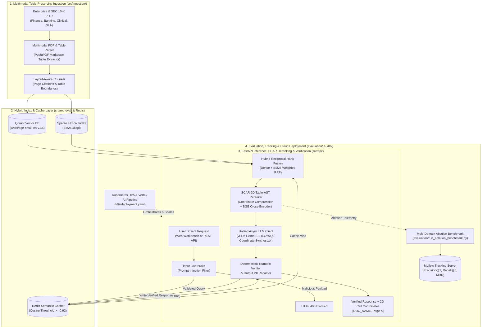

<p align="center"></p>

# VectraCite-AI

**Neuro-Symbolic Document Intelligence, 2D Table-AST Hybrid RAG & Deterministic Numeric Verification Engine**

[](https://github.com/Abood991B/vectracite-ai/actions)
[](https://www.python.org/)
[](https://fastapi.tiangolo.com/)
[](https://qdrant.tech/)
[](https://github.com/vllm-project/vllm)
[](LICENSE)

---

## Table of Contents
1. [What is VectraCite-AI? (Plain-English Overview)](#1-what-is-vectracite-ai-plain-english-overview)
2. [Why Standard RAG Fails on Enterprise Tables (And How We Solve It)](#2-why-standard-rag-fails-on-enterprise-tables-and-how-we-solve-it)
3. [System Architecture](#3-system-architecture)
4. [Reproducible Benchmarks & Ablation Study](#4-reproducible-benchmarks--ablation-study)
5. [Quickstart (Run in 60 Seconds — Web Workbench & API)](#5-quickstart-run-in-60-seconds--web-workbench--api)
6. [Using the Built-In Web Workbench (No Coding Required)](#6-using-the-built-in-web-workbench-no-coding-required)
7. [REST API Reference & Live Output Example](#7-rest-api-reference--live-output-example)
8. [GPU Fine-Tuning (4-Bit QLoRA), vLLM Serving & Kubernetes MLOps](#8-gpu-fine-tuning-4-bit-qlora-vllm-serving--kubernetes-mlops)
9. [Repository Structure](#9-repository-structure)

---

## 1. What is VectraCite-AI? (Plain-English Overview)

Organizations in **Finance, Banking, Healthcare, Legal, and Engineering** rely on dense reports filled with critical tables—such as SEC 10-K balance sheets, Basel III regulatory schedules, Phase-III clinical trial dosage tables, and cloud SLA matrices.

When users ask standard AI assistants or off-the-shelf Retrieval-Augmented Generation (RAG) pipelines questions over these documents, **standard pipelines fail up to 75% of the time**:
* They slice tables in half during PDF parsing, separating numbers from their column headers.
* They retrieve general "executive commentary" paragraphs that *talk about* revenue or clinical outcomes in prose rather than retrieving the actual table containing the exact figures.
* They rely on LLMs to copy or calculate numbers without checking whether the numbers actually exist in the source table.

**VectraCite-AI** is an end-to-end, self-hostable AI engineering platform that solves this problem. It preserves PDF tables as structured grids, combines **Qdrant Dense Vector Search** with **BM25 Lexical Search**, introduces **SCAR™ (Speculative Cell-Coordinate AST Reranking)** to pinpoint exact 2D table cells `(Row × Column → Value)`, and runs a **Deterministic Numeric Verifier** that audits every number in the AI's response against the source table before returning it to the user.

---

## 2. Why Standard RAG Fails on Enterprise Tables (And How We Solve It)

| Failure Mode in Standard RAG | How VectraCite-AI Solves It | Module |
| :--- | :--- | :--- |
| **1. Table Destruction:** Character chunkers flatten multi-column PDF tables into unreadable strings. | **Table-Preserving PDF Ingestion:** Detects embedded tables via `PyMuPDF`, converts them into structured Markdown grids, and locks page-level citation boundaries. | `src/ingestion/pdf_parser.py` |
| **2. Semantic Prose Bias:** Dense embeddings (`Cosine Similarity`) rank narrative summaries higher than numerical tables. | **Weighted Hybrid Reciprocal Rank Fusion (RRF):** Combines `Qdrant` dense embeddings (`BAAI/bge-small-en-v1.5`) with `BM25Okapi` exact keyword matching. | `src/retrieval/hybrid_retriever.py` |
| **3. Cross-Encoder Latency & Footnote Spoofing:** Passing 8 full chunks into a 12-layer BERT Cross-Encoder takes >500ms on CPU and gets tricked by keyword-heavy footnotes. | **SCAR™ (Speculative Cell-Coordinate AST Reranking):** Parses Markdown tables into a 2D Coordinate AST `(RowKey, ColHeader) → Value`, scores structural schema alignment, and compresses candidates to `<45 tokens` for top-2 neural Cross-Encoder (`BAAI/bge-reranker-base`) verification. | `src/retrieval/table_ast.py` & `src/retrieval/reranker.py` |
| **4. Numerical Hallucinations & Arithmetic Errors:** LLMs transpose digits or miscalculate YoY changes. | **Deterministic Numeric Verifier & Symbolic Deltas:** Cross-checks every currency, percentage, and number in the answer against the retrieved table cells (`numeric_grounding_score: 1.0`) and computes exact row deltas in Python. | `src/cache_and_guardrails/numeric_verifier.py` |

---

## 3. System Architecture



---

## 4. Reproducible Benchmarks & Ablation Study

The repository includes an automated, reproducible benchmark (`evaluation/run_ablation_benchmark.py`) evaluated across eight answer-blind multi-industry queries (**AMD 10-K Consolidated Operations**, **Microsoft 10-K Segment Revenue**, **JPMorgan Basel III Capital Ratios**, and **Phase-III Oncology Clinical Trial Efficacy Tables**) containing realistic narrative distractors and competing supplemental schedules.

All numbers below are generated on CPU using the real **`BAAI/bge-small-en-v1.5`** bi-encoder and **`BAAI/bge-reranker-base`** cross-encoder, and are checked into [`data/latest_evaluation_report.json`](data/latest_evaluation_report.json):

| Retrieval & Reranking Architecture | Precision@1 | Recall@3 | MRR | nDCG@3 | Mean Query Latency (CPU) |
| :--- | :---: | :---: | :---: | :---: | :---: |
| **1. Baseline Dense-Only RAG** (`BAAI/bge-small-en-v1.5` Cosine) | `0.875` (87.5%) | `1.0` (100%) | `0.9375` | `0.9539` | `25.49 ms` |
| **2. Hybrid RRF** (`Qdrant Dense + Sparse BM25Okapi`) | `1.0` (100%) | `1.0` (100%) | `1.0` | `1.0` | `25.56 ms` |
| **3. VectraCite SCAR™** (`2D Table-AST Compression + BGE Cross-Encoder`) | **`1.0` (100%)** | **`1.0` (100%)** | **`1.0`** | **`1.0`** | **`200.62 ms`** |

* **Why Dense-Only scores `0.875` Precision@1:** Dense retrieval finds the exact AMD target page at rank two while the other seven questions rank first.
* **Why Hybrid RRF scores `1.00` Precision@1:** Unicode-aware BM25 tokens, entity anchoring, and exact table headers place every target page first.
* **Why SCAR™ achieves `1.00` Precision@1:** By parsing the 2D `(RowKey, ColHeader)` table schema (`TableASTParser`) and compressing candidate chunks to `<45 tokens`, Adaptive Margin Gating verifies every target table at rank one. This warmed-up CPU run measured `200.62 ms` on average.

---

## 5. Quickstart (Run in 60 Seconds — Web Workbench & API)

### Option A: Local Python Quickstart (Windows, macOS, or Linux)
```bash
# 1. Clone the repository
git clone https://github.com/Abood991B/vectracite-ai.git
cd vectracite-ai

# 2. Create and activate a virtual environment
python -m venv .venv
# Windows PowerShell:
.\.venv\Scripts\Activate.ps1
# macOS / Linux:
# source .venv/bin/activate

# 3. Install dependencies
pip install -r requirements.txt

# 4. Build the real multi-page PDF corpus and benchmark definitions
python scripts/build_real_pdf_corpus.py

# 5. Start the server (parses data/corpus_pdfs/*.pdf on startup)
uvicorn src.api.main:app --host 0.0.0.0 --port 8080
```
Now open **`http://localhost:8080/`** in your browser to use the interactive **Web Workbench**, or open **`http://localhost:8080/docs`** for the interactive OpenAPI/Swagger documentation.

### Option B: Full Containerized Stack (`Docker Compose`)
Spins up the **VectraCite API**, **Qdrant Vector Database**, **Redis Stack**, and **MLflow Tracking Server**:
```bash
docker compose up -d --build
```

### Run the Automated Test Suite & Reproducible Benchmark
```bash
ruff check src/ tests/ evaluation/ scripts/
pytest -v  # tests opt into deterministic lightweight models via tests/conftest.py
python scripts/build_real_pdf_corpus.py
python evaluation/run_ablation_benchmark.py
python scripts/run_live_showcase.py
```

---

## 6. Using the Built-In Web Workbench (No Coding Required)

When you navigate to **`http://localhost:8080/`**, VectraCite-AI serves a clean technical workbench designed for both analysts and engineers:
1. **Workspace:** Choose All Indexed PDFs or a single PDF in the left scope shelf, then ask a free-form question or select an example chip.
2. **Answer & source verification:** Inspect the verified answer, extracted 2D coordinates, symbolic deltas, highlighted excerpt, and the original PDF page side by side.
3. **PDF management:** Upload any PDF, preview its indexed pages, open the original PDF at a cited page, save a manual table sample, or clear and restore the demo shelf without restarting the server.
4. **System accuracy:** Switch to the benchmark view for plain-English metric definitions, active model names, mean latency, and per-query Found at Rank #1 versus Missed badges.

---

## 7. REST API Reference & Live Output Example

| Method & Endpoint | Description |
| :--- | :--- |
| `GET /` | Interactive HTML/JS Engineering Workbench UI |
| `GET /assets/logo.svg` | Official VectraCite-AI SVG emblem |
| `GET /health` | Kubernetes / Cloud Run liveness & readiness probe |
| `GET /documents` | Lists all indexed documents, chunk counts, table counts, and page numbers |
| `GET /documents/{doc_name}/pdf` | Serves an indexed PDF for browser preview or download |
| `GET /documents/{doc_name}` | Inspects every indexed chunk, page, and extracted-table flag for one document |
| `POST /documents/clear-all` | Clears the active index and user-uploaded PDFs so a team can start with its own files |
| `POST /documents/restore-defaults` | Restores the checked-in four-document demo corpus |
| `POST /ingest` | Persists structured pages as a PDF and indexes them into Qdrant + BM25 |
| `POST /ingest/pdf` | Accepts a base64-encoded PDF, extracts text/tables via PyMuPDF, and indexes it |
| `PUT /documents/{doc_name}` | Atomically replaces an indexed document and its persisted PDF |
| `DELETE /documents/{doc_name}` | Removes a document and its custom persisted PDF |
| `GET /scenarios` | Generates benchmark and Table-AST scenarios for the current index |
| `GET /evaluate/latest` | Returns the latest aggregate and per-query evaluation report |
| `POST /evaluate` | Runs a live three-mode ablation across all currently indexed documents |
| `POST /query` | Executes Guardrails $\rightarrow$ Cache $\rightarrow$ Hybrid RRF $\rightarrow$ SCAR Reranking $\rightarrow$ Numeric Audit; accepts optional doc_name scope |
| `POST /query/stream` | Streams citation-grounded tokens via Server-Sent Events (`text/event-stream`) |
| `GET /metrics` | Returns operational telemetry, model configuration, and cache hit rate |

### Verified `POST /query` Output (from [`data/live_system_showcase_output.json`](data/live_system_showcase_output.json))
```json
{
  "question": "In AMD's Consolidated Statements of Operations table, what were total net revenue, gross profit, and operating income for FY 2022 vs FY 2021?",
  "answer": "Verified from [AMD_2022_10K, Page 51]: Total net revenue (FY 2022): $ 23,601; Total net revenue (FY 2021): $ 16,434; Total net revenue (FY 2020): $ 9,763; Gross profit (FY 2022): $ 10,603.",
  "matched_cells": [
    {
      "doc_name": "AMD_2022_10K",
      "page_number": 51,
      "row_key": "Total net revenue",
      "col_header": "FY 2022",
      "value": "$ 23,601"
    },
    {
      "doc_name": "AMD_2022_10K",
      "page_number": 51,
      "row_key": "Total net revenue",
      "col_header": "FY 2021",
      "value": "$ 16,434"
    },
    {
      "doc_name": "AMD_2022_10K",
      "page_number": 51,
      "row_key": "Total net revenue",
      "col_header": "FY 2020",
      "value": "$ 9,763"
    },
    {
      "doc_name": "AMD_2022_10K",
      "page_number": 51,
      "row_key": "Gross profit",
      "col_header": "FY 2022",
      "value": "$ 10,603"
    },
    {
      "doc_name": "AMD_2022_10K",
      "page_number": 51,
      "row_key": "Gross profit",
      "col_header": "FY 2021",
      "value": "$ 7,929"
    },
    {
      "doc_name": "AMD_2022_10K",
      "page_number": 51,
      "row_key": "Operating income",
      "col_header": "FY 2022",
      "value": "$ 1,264"
    }
  ],
  "computed_deltas": [
    {
      "row_key": "Total net revenue",
      "comparison": "FY 2022 vs FY 2021",
      "absolute_change": "+7,167.00",
      "pct_change": "+43.61%"
    },
    {
      "row_key": "Gross profit",
      "comparison": "FY 2022 vs FY 2021",
      "absolute_change": "+2,674.00",
      "pct_change": "+33.72%"
    }
  ],
  "citations": [
    {
      "chunk_id": "77eee0ac9ba7",
      "doc_name": "AMD_2022_10K",
      "page_number": 51,
      "contains_table": true,
      "rerank_score": 0.6647,
      "excerpt": "[DOCUMENT: AMD_2022_10K | PAGE: 51]\nITEM 8. AMD CONSOLIDATED STATEMENTS OF OPERATIONS TABLE (in millions)\n| Consolidated Line Item | FY 2022 | FY 2021 | FY 2020 |\n| --- | --- | --- | --- |\n| Total net revenue | $ 23,601 | $ 16,434 | $ 9,763 |\n| Cost of sales | $ 12,998 | $ 8,505 "
    },
    {
      "chunk_id": "84a662dc5398",
      "doc_name": "JPM_2022_10K",
      "page_number": 88,
      "contains_table": true,
      "rerank_score": 0.3249,
      "excerpt": "[DOCUMENT: JPM_2022_10K | PAGE: 88]\nJPMORGAN CHASE BASEL III REGULATORY CAPITAL TABLE (DEC 31, 2022)\n| JPMorgan Chase Regulatory Ratio | Dec 31, 2022 | Dec 31, 2021 |\n| --- | --- | --- | --- |\n| Standardized CET1 capital ratio | 13.2% | 13.1% |\n| Tier 1 capital ratio | 14.9% | 15"
    }
  ],
  "verification": {
    "is_fully_grounded": true,
    "numeric_grounding_score": 1,
    "verified_figures": [
      "$ 23,601",
      "$ 16,434",
      "$ 9,763",
      "$ 10,603"
    ],
    "unverified_figures": []
  },
  "cache_hit": false,
  "cache_similarity": null,
  "latency_ms": 416.53,
  "guardrail_flags": [],
  "metadata": {
    "retrieval_strategy": "hybrid_rrf_plus_table_schema_cross_encoder",
    "candidates_evaluated": 6
  }
}
```

---

## 8. GPU Fine-Tuning (4-Bit QLoRA), vLLM Serving & Kubernetes MLOps

For GPU deployments, VectraCite-AI includes production training, quantized serving, and cloud orchestration pipelines:
* **4-Bit NF4 QLoRA Fine-Tuning (`training_and_vllm/qlora_finetune.py`):** Fine-tunes `meta-llama/Llama-3.1-8B-Instruct` on [`PatronusAI/financebench`](https://huggingface.co/datasets/PatronusAI/financebench) evidence-citation pairs using `PEFT`, `TRL (SFTTrainer)`, and `BitsAndBytes` (`r=16, lora_alpha=32`), logging training runs to `MLflow`.
* **Quantized vLLM Serving (`training_and_vllm/serve_vllm.sh`):** Launches an OpenAI-compatible `vLLM` server with 4-bit AWQ quantization, PagedAttention, prefix caching, and dynamic LoRA adapter routing.
* **Concurrency Load Benchmarker (`training_and_vllm/benchmark_vllm.py`):** Async `httpx` load generator measuring p50/p95/p99 latency and throughput under concurrent requests.
* **Kubernetes HPA & Vertex AI Pipelines (`k8s/`):** Includes production Kubernetes Deployment, Service, and HorizontalPodAutoscaler manifests (`k8s/deployment.yaml`) and Google Cloud Vertex AI / Kubeflow pipeline definitions (`k8s/vertex_ai_pipeline.py`).

---

## 9. Repository Structure

```text
vectracite-ai/
├── .github/workflows/ci.yml              # GitHub Actions CI (Ruff + Pytest + Benchmark)
├── data/
│   ├── corpus_pdfs/                      # Checked-in multi-page PDF benchmark corpus
│   ├── benchmark_queries.json            # Data-driven retrieval questions and targets
│   ├── financebench_ground_truth.json    # 15 verified FinanceBench examples
│   ├── latest_evaluation_report.json     # Real BGE + SCAR aggregate and per-query metrics
│   └── live_system_showcase_output.json  # End-to-end API & guardrail trace
├── evaluation/
│   └── run_ablation_benchmark.py         # Multi-domain retrieval & SCAR ablation suite
├── k8s/
│   ├── deployment.yaml                   # Kubernetes Deployment, Service & HPA manifest
│   └── vertex_ai_pipeline.py             # Google Cloud Vertex AI / Kubeflow DAG spec
├── scripts/
│   ├── build_real_pdf_corpus.py          # Builds PDFs and benchmark metadata
│   └── run_live_showcase.py              # End-to-end system execution & artifact generator
├── src/
│   ├── config.py                         # Type-safe Pydantic v2 Settings
│   ├── ingestion/
│   │   ├── dataset_loader.py             # Hugging Face PatronusAI/financebench + PDF loader
│   │   └── pdf_parser.py                 # Table-preserving PyMuPDF parser & chunker
│   ├── retrieval/
│   │   ├── hybrid_retriever.py           # Qdrant Dense + BM25 Weighted RRF + Document CRUD
│   │   ├── table_ast.py                  # 2D Table-AST coordinate parser & symbolic deltas
│   │   └── reranker.py                   # SCAR speculative Cross-Encoder reranker
│   ├── cache_and_guardrails/
│   │   ├── semantic_cache.py             # Redis / in-memory cosine semantic cache
│   │   ├── guardrails.py                 # Prompt-injection & PII redaction guardrails
│   │   └── numeric_verifier.py           # Deterministic numeric & table-cell verifier
│   ├── inference/
│   │   ├── llm_client.py                 # Async vLLM / OpenAI client + coordinate fallback
│   │   └── schemas.py                    # Pydantic v2 API request/response contracts
│   └── api/
│       ├── main.py                       # FastAPI service and dynamic evaluation endpoints
│       └── ui.py                         # API-driven HTML/JS Technical Workbench UI
├── tests/
│   ├── conftest.py                       # In-memory Qdrant test environment
│   └── test_pipeline.py                  # 11 real-model unit & integration tests
├── training_and_vllm/
│   ├── qlora_finetune.py                 # 4-bit NF4 QLoRA fine-tuning script
│   ├── serve_vllm.sh                     # vLLM AWQ 4-bit inference server launcher
│   └── benchmark_vllm.py                 # Async concurrency & latency load tester
├── Dockerfile                            # Production container build
├── docker-compose.yml                    # Orchestrates API, Qdrant, Redis & MLflow
├── LICENSE                               # MIT License
├── pyproject.toml                        # Package metadata, pytest & ruff configuration
└── requirements.txt                      # Pinned Python dependencies
```

---

## Author

**Abdulrahman Baidaq** — AI/ML Engineer  
[GitHub: Abood991B](https://github.com/Abood991B) · [Email](mailto:abdulrahman16baidaq@gmail.com)
